# Supplied family photo and cookbook reference library

40 unique photographs/screenshots/reference illustrations, each with a separate preview. Unedited user originals remain private and unchanged. Library copies omit embedded metadata. Any opaque background-writing privacy edit is noted per image; people, food and full framing are retained.

**Public repository:** these files are publicly downloadable. Family photographs and external reference illustrations are clearly separated. No prescriptions, identity/contact documents, raw source records, videos or generated mockups are included.

Use [manifest.json](manifest.json) for filenames, verified bilingual food captions, source aliases and edit notes. Food labels are supplied by the family, not inferred from appearance. Reference pictures do not establish the family recipe or filling. No recipe quantities or medical advice are inferred.

## Family-confirmed dishes and food moments

| Preview / file | English caption | Bahasa Indonesia |
|---|---|---|
|  [F01-plain-congee-daliang-milk.png](food/F01-plain-congee-daliang-milk.png) | Plain rice congee with Daliang salted milk / Shunde milk slices | Bubur putih dengan Daliang salted milk / Shunde milk slices |
| <a href="food/F02-sweet-corn-egg-milk-honey-water.png">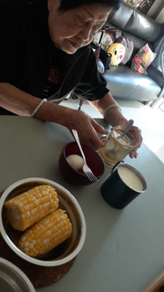</a> [F02-sweet-corn-egg-milk-honey-water.png](food/F02-sweet-corn-egg-milk-honey-water.png) | Steamed sweet corn, boiled egg, milk and honey water | Jagung manis kukus, telur rebus, susu dan air madu |
|  [F03-scrambled-egg-sandwiches-honey-ginger-water.png](food/F03-scrambled-egg-sandwiches-honey-ginger-water.png) | Scrambled-egg sandwiches with honey-ginger water | Roti lapis telur orak-arik dan air madu jahe |
|  [F04-rice-rolls-lemon-honey-ginger-water.png](food/F04-rice-rolls-lemon-honey-ginger-water.png) | Steamed rice rolls, pepper and soy sauce; lemon-honey-ginger water | Gulungan nasi kukus, lada dan kecap asin; air lemon madu jahe |
|  [F07-fish-congee-lettuce-ginger.png](food/F07-fish-congee-lettuce-ginger.png) | Fish congee with Chinese lettuce and ginger | Bubur ikan dengan selada Tionghoa dan jahe |
|  [F08-steamed-sweet-potato-egg-honey-ginger-water.png](food/F08-steamed-sweet-potato-egg-honey-ginger-water.png) | Steamed sweet potato, sometimes with egg, and honey-ginger water | Ubi kukus, kadang dengan telur, dan air madu jahe |
|  [F13-steamed-fish-chinese-lettuce-dinner.png](food/F13-steamed-fish-chinese-lettuce-dinner.png) | Steamed fish with Chinese lettuce | Ikan kukus dengan selada Tionghoa |
| <a href="food/R01-plain-congee-daliang-milk.png">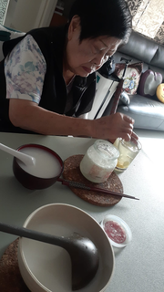</a> [R01-plain-congee-daliang-milk.png](food/R01-plain-congee-daliang-milk.png) | Plain rice congee with Daliang salted milk (Shunde milk slices), the hometown accompaniment described as Chinese cheese. Popo adds it herself from the jar. | Bubur putih dengan Daliang milk (olahan susu asin dari Shunde), yang keluarga sebut keju Cina. Popo menambahkannya sendiri dari stoples. |
|  [R02-steamed-rice-rolls-honey-lemon-water.png](food/R02-steamed-rice-rolls-honey-lemon-water.png) | Steamed rice rolls with soy sauce, served with honey-lemon water. | Sarapan: cheung fun (rice rolls) kukus dengan kecap asin, disajikan bersama air madu lemon. |
| <a href="food/R04-popo-making-shanghai-wontons.png">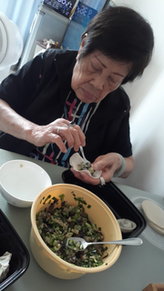</a> [R04-popo-making-shanghai-wontons.png](food/R04-popo-making-shanghai-wontons.png) | Popo wrapping home-made Shanghainese chicken wontons for weekend lunch—a favourite she used to make for the family. | Popo membungkus pangsit ayam ala Shanghai untuk makan siang akhir pekan—makanan kesukaan yang dulu ia buat untuk keluarga. |
|  [R05-finished-home-made-shanghai-wontons.png](food/R05-finished-home-made-shanghai-wontons.png) | The finished home-made Shanghainese wontons prepared with Popo—paired with the photograph of her wrapping them. | Hasil pangsit ala Shanghai yang dibuat bersama Popo—dipasangkan dengan foto saat ia membungkusnya. |
| <a href="food/R06-wonton-noodles-vegetables-white-pepper.png">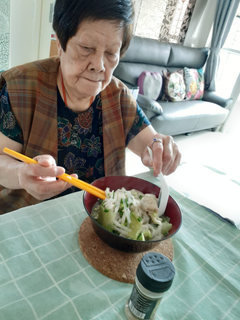</a> [R06-wonton-noodles-vegetables-white-pepper.png](food/R06-wonton-noodles-vegetables-white-pepper.png) | Saturday lunch: wonton noodles with vegetables, with a bottle of white pepper available at the table. | Makan siang Sabtu: mi pangsit dengan sayuran. Lada putih tersedia di meja. |
| <a href="food/R07-dragon-fruit-painting-break.png">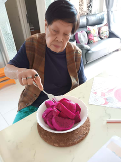</a> [R07-dragon-fruit-painting-break.png](food/R07-dragon-fruit-painting-break.png) | Dragon fruit, Popo’s favourite fruit treat, during a short painting break on Saturday or Sunday. | Buah naga, buah kesukaan Popo, sebagai camilan saat jeda singkat melukis pada Sabtu atau Minggu. |
|  [R08-chicken-feet-pot-rice-tempeh-choy-sum.png](food/R08-chicken-feet-pot-rice-tempeh-choy-sum.png) | Dinner: Chinese chicken-feet pot rice with ginger and oyster sauce, tempeh, choy sum, and winter-melon soup with coriander and egg drop. | Makan malam: nasi pot ceker ayam dengan jahe dan saus tiram, tempe, caisim, serta sup kundur dengan daun ketumbar dan telur. |
| <a href="food/R09-steamed-fish-ginger-spring-onion-choy-sum.png">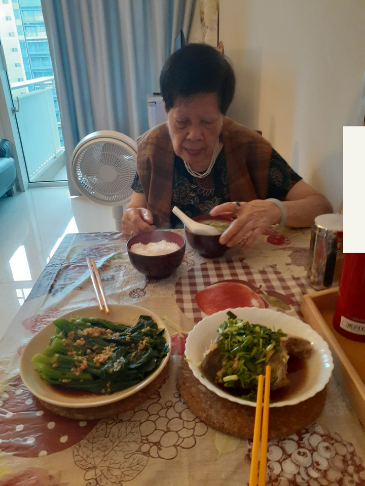</a> [R09-steamed-fish-ginger-spring-onion-choy-sum.png](food/R09-steamed-fish-ginger-spring-onion-choy-sum.png) | Dinner: steamed fish with plenty of ginger, spring onion and soy sauce, served with choy sum and minced ginger; the vegetables may be steamed or pan-fried. Background writing hidden for privacy. | Makan malam: ikan kukus dengan banyak jahe, daun bawang dan kecap asin, disajikan dengan caisim dan jahe cincang. Sayur dapat dikukus atau ditumis. |
| <a href="food/R10-japanese-chicken-curry-potato-carrot.png">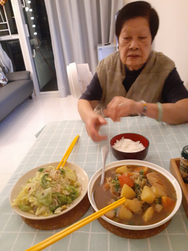</a> [R10-japanese-chicken-curry-potato-carrot.png](food/R10-japanese-chicken-curry-potato-carrot.png) | Dinner: Japanese curry made from a curry block with potato, red carrot, chopped coriander and chicken wings or chicken meat, served with Chinese lettuce and white rice. | Makan malam: kari Jepang dari blok kari, dengan kentang, wortel merah, daun ketumbar cincang dan sayap atau daging ayam, disajikan bersama selada Cina dan nasi putih. |
| <a href="food/S01-sweet-potato-snow-fungus-sweet-soup.png">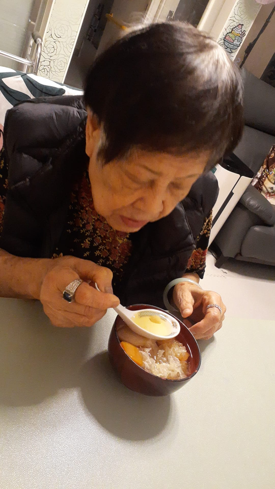</a> [S01-sweet-potato-snow-fungus-sweet-soup.png](food/S01-sweet-potato-snow-fungus-sweet-soup.png) | Popo eating sweet-potato and snow-fungus sweet soup, made with Chinese yellow sugar; an after-centre or weekend-afternoon treat. | Popo makan sup manis ubi jalar dan jamur salju dengan gula kuning Cina; camilan sepulang dari pusat kegiatan atau sore akhir pekan. |
| <a href="food/DIN01-eel-pot-rice-lettuce-winter-melon-egg-soup.png">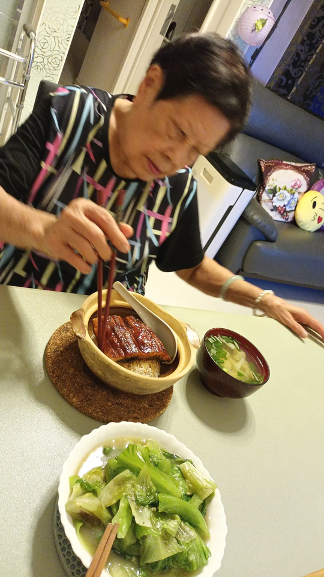</a> [DIN01-eel-pot-rice-lettuce-winter-melon-egg-soup.png](food/DIN01-eel-pot-rice-lettuce-winter-melon-egg-soup.png) | Dinner: eel pot rice, Chinese lettuce and winter-melon and egg soup. | Makan malam: nasi pot belut, selada Cina, serta sup kundur dan telur. |
| <a href="food/DIN02-tomato-egg-chinese-lettuce.png">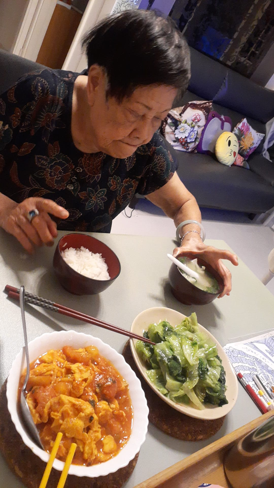</a> [DIN02-tomato-egg-chinese-lettuce.png](food/DIN02-tomato-egg-chinese-lettuce.png) | Dinner: pan-fried tomato and egg with Chinese lettuce. | Makan malam: tumis tomat dan telur dengan selada Cina. |
| <a href="food/DIN03-chinese-egg-pancake-mustard-greens-ginger-soup.png">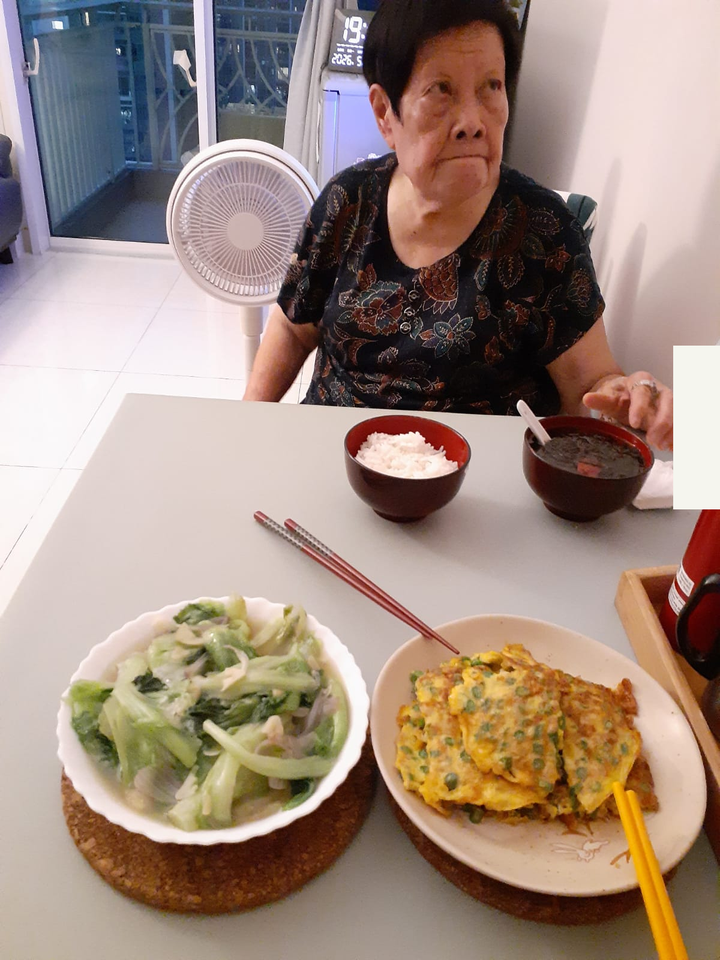</a> [DIN03-chinese-egg-pancake-mustard-greens-ginger-soup.png](food/DIN03-chinese-egg-pancake-mustard-greens-ginger-soup.png) | Dinner: Chinese egg pancake with onion, shredded green beans, minced ginger and garlic; Chinese lettuce; and mustard-greens soup with plenty of ginger and no added seasoning. Background writing hidden for privacy. | Makan malam: telur dadar ala Cina dengan bawang bombai, buncis iris, jahe dan bawang putih cincang; selada Cina; serta sup sawi pahit dengan banyak jahe, tanpa bumbu tambahan. |
| <a href="food/DIN04-silky-steamed-egg-lettuce-vegetable-soup.png">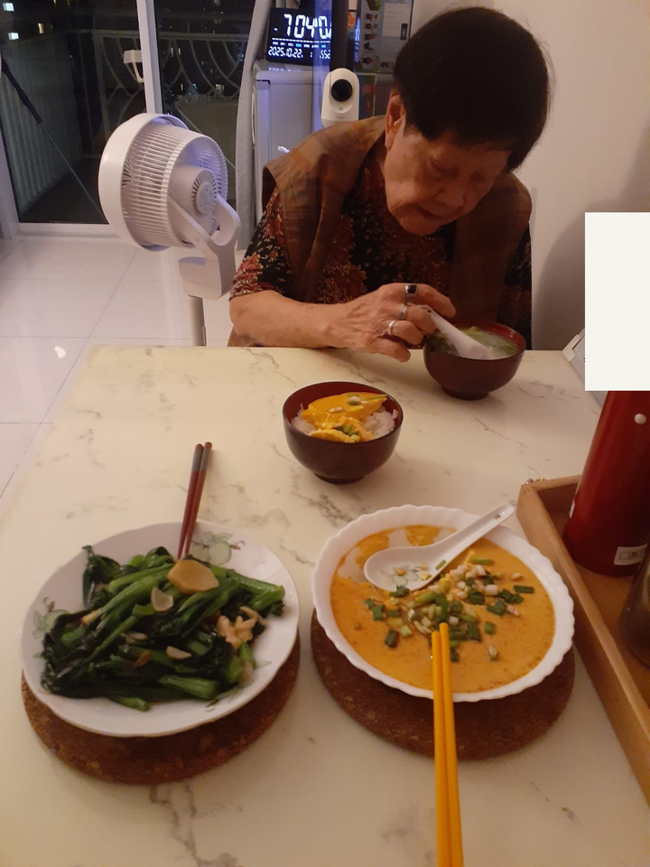</a> [DIN04-silky-steamed-egg-lettuce-vegetable-soup.png](food/DIN04-silky-steamed-egg-lettuce-vegetable-soup.png) | Dinner: silky Chinese steamed egg with lettuce and vegetable soup. Background writing hidden for privacy. | Makan malam: telur kukus ala Cina yang lembut, selada dan sup sayuran. |
| <a href="food/DIN05-steamed-chicken-lily-buds-cloud-ear-fungus.png">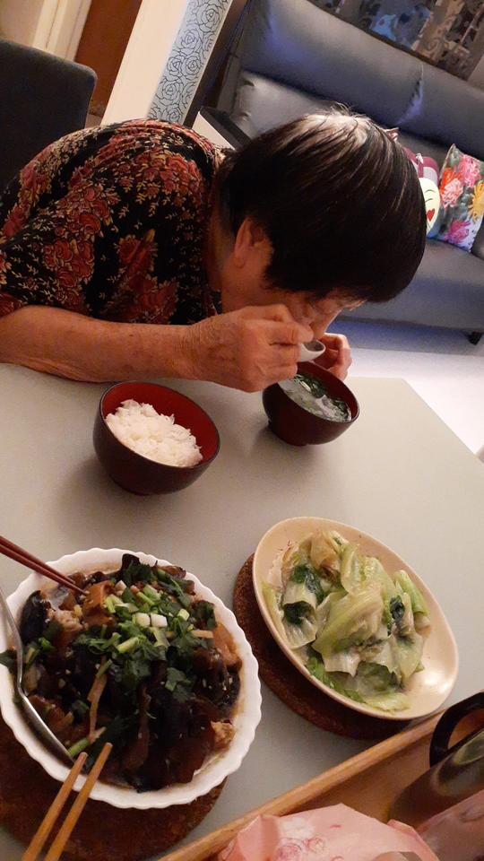</a> [DIN05-steamed-chicken-lily-buds-cloud-ear-fungus.png](food/DIN05-steamed-chicken-lily-buds-cloud-ear-fungus.png) | Dinner: steamed chicken with dried lily buds and cloud ear fungus, lettuce and vegetable soup. | Makan malam: ayam kukus dengan kuncup bunga lili kering dan jamur kuping, selada dan sup sayuran. |

## Supplied recipe illustrations—not the helper’s cooking

| Preview / file | English caption | Bahasa Indonesia |
|---|---|---|
| <a href="references/REF01-stuffed-tofu-pocket-illustration.png">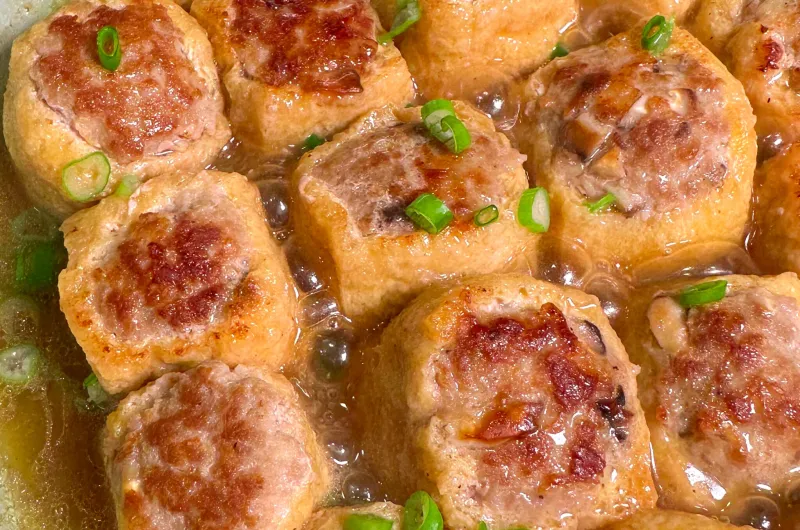</a> [REF01-stuffed-tofu-pocket-illustration.png](references/REF01-stuffed-tofu-pocket-illustration.png) | Reference illustration of stuffed tofu pockets, not the helper’s cooking. The pictured filling is not verified; Popo’s version uses minced fish, not beef. | Ilustrasi kantong tahu isi, bukan masakan pendamping. Isian di gambar belum dipastikan; versi Popo memakai ikan cincang, bukan daging sapi. |
| <a href="references/REF02-steamed-tofu-illustration.png">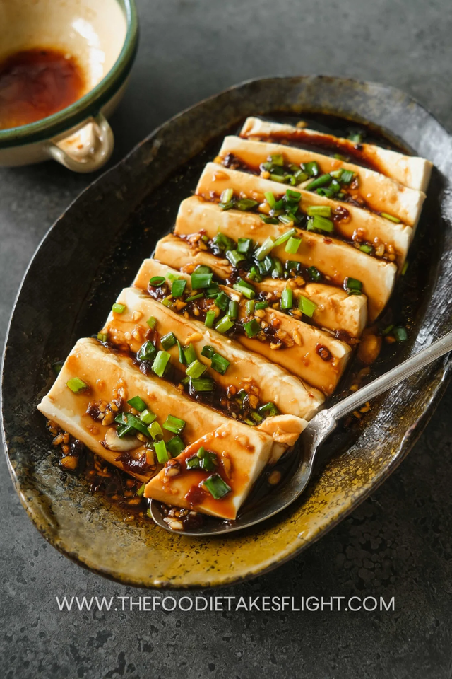</a> [REF02-steamed-tofu-illustration.png](references/REF02-steamed-tofu-illustration.png) | Steamed-tofu reference illustration supplied by the family, from The Foodie Takes Flight. The pictured sauce is not the confirmed family recipe. | Ilustrasi tahu kukus dari The Foodie Takes Flight yang dibagikan keluarga. Saus di gambar bukan resep keluarga yang sudah dikonfirmasi. |

## Popo’s activities and everyday moments

| Preview / file | English caption | Bahasa Indonesia |
|---|---|---|
|  [popo-accessories-and-sunglasses.png](popo/popo-accessories-and-sunglasses.png) | Popo wearing sunglasses; our current helper helped choose them. The family says she enjoys accessories and compliments. | — |
|  [popo-reading-newspaper.png](popo/popo-reading-newspaper.png) | Popo reading her Chinese newspaper. | — |
|  [popo-colouring-focused.png](popo/popo-colouring-focused.png) | Popo concentrating on colouring/artwork. | — |
|  [popo-colouring-second-photo.png](popo/popo-colouring-second-photo.png) | A second supplied moment during artwork. | — |
|  [popo-enjoying-helper-pandan-jelly.png](popo/popo-enjoying-helper-pandan-jelly.png) | Popo enjoying pandan jelly made by our current helper. | — |
|  [popo-ice-cream-outing-01.png](popo/popo-ice-cream-outing-01.png) | Popo enjoying ice cream on an outing. | — |
| <a href="popo/morning-music-on-tv.png">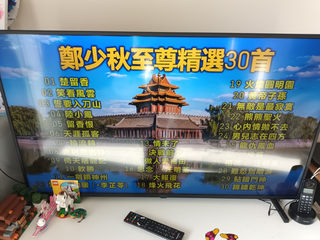</a> [morning-music-on-tv.png](popo/morning-music-on-tv.png) | Supplied morning TV/music photograph; our current helper prepares familiar YouTube music. | — |
|  [popo-at-table.png](popo/popo-at-table.png) | Popo seated at a table; exact food/drink label has not been supplied. | — |
| <a href="popo/popo-eating-meal.png">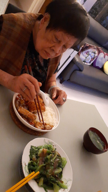</a> [popo-eating-meal.png](popo/popo-eating-meal.png) | Popo eating a meal; exact dish/ingredients are not confirmed. | — |
|  [popo-reading-leaflet.png](popo/popo-reading-leaflet.png) | Popo reading a leaflet; do not infer a particular class or location. | — |
| <a href="popo/popo-in-vehicle.png">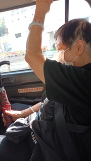</a> [popo-in-vehicle.png](popo/popo-in-vehicle.png) | Popo travelling in a vehicle during an outing. | — |
| <a href="popo/popo-ice-cream.png">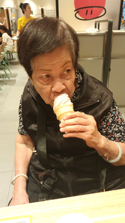</a> [popo-ice-cream.png](popo/popo-ice-cream.png) | A further ice-cream outing photograph. | — |
| <a href="popo/newspapers-in-lobby.png">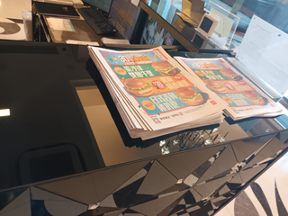</a> [newspapers-in-lobby.png](popo/newspapers-in-lobby.png) | Newspapers in the lobby, where our current helper reports collecting the newspaper. | — |

## The helper and shared family moments

| Preview / file | English caption | Bahasa Indonesia |
|---|---|---|
|  [helper-portrait.png](helper/helper-portrait.png) | Our current helper’s portrait, supplied for the introduction/testimonial. | — |
|  [helper-with-popo.png](helper/helper-with-popo.png) | Our current helper with Popo, supplied for the introduction/testimonial. | — |

## Supplied activity screenshot

| Preview / file | English caption | Bahasa Indonesia |
|---|---|---|
|  [park-exercise-whatsapp-screenshot.png](activity-screenshots/park-exercise-whatsapp-screenshot.png) | Supplied WhatsApp screenshot of park-exercise video previews; not an actual video or a reviewed exercise demonstration. | — |
