# Supplied Popo / our current helper / food photo library

32 full-resolution, unique source photographs/screenshots are indexed below, plus the five existing demo image derivatives. Originals remain unchanged locally. Library copies omit EXIF/text metadata and preserve image pixels, dimensions and complete framing; small previews are separate.

**Public repository:** these images are publicly downloadable. No prescriptions, identity/contact documents, videos, external research-site images or generated mockups are included.

For Copilot, use [manifest.json](manifest.json). Captions come from supplied family labels and existing source records, not new image analysis. A label-pending picture is not evidence of a favourite dish, ingredients, an approved current menu or a recipe. Do not infer medical conditions or new care procedures from a photograph.

## Popo’s activities and everyday moments

| Preview | File | Supplied context |
|---|---|---|
|  | [popo-accessories-and-sunglasses.png](popo/popo-accessories-and-sunglasses.png) | Popo wearing sunglasses; our current helper helped choose them. The family says she enjoys accessories and compliments. |
| <a href="popo/popo-reading-newspaper.png">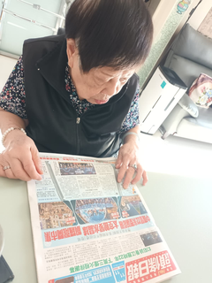</a> | [popo-reading-newspaper.png](popo/popo-reading-newspaper.png) | Popo reading her Chinese newspaper. |
| <a href="popo/popo-colouring-focused.png">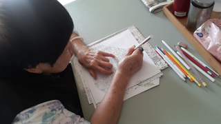</a> | [popo-colouring-focused.png](popo/popo-colouring-focused.png) | Popo concentrating on colouring/artwork. |
| <a href="popo/popo-colouring-second-photo.png">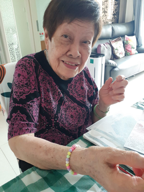</a> | [popo-colouring-second-photo.png](popo/popo-colouring-second-photo.png) | A second supplied moment during artwork. |
| <a href="popo/popo-enjoying-helper-pandan-jelly.png">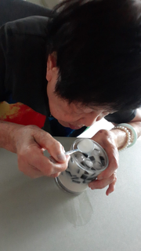</a> | [popo-enjoying-helper-pandan-jelly.png](popo/popo-enjoying-helper-pandan-jelly.png) | Popo enjoying pandan jelly made by our current helper. |
| <a href="popo/popo-ice-cream-outing-01.png">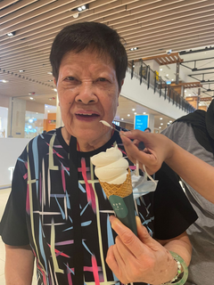</a> | [popo-ice-cream-outing-01.png](popo/popo-ice-cream-outing-01.png) | Popo enjoying ice cream on an outing. |
|  | [morning-music-on-tv.png](popo/morning-music-on-tv.png) | Supplied morning TV/music photograph; our current helper prepares familiar YouTube music. |
| <a href="popo/popo-at-table.png">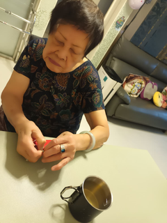</a> | [popo-at-table.png](popo/popo-at-table.png) | Popo seated at a table; exact food/drink label has not been supplied. |
|  | [popo-eating-meal.png](popo/popo-eating-meal.png) | Popo eating a meal; exact dish/ingredients are not confirmed. |
| <a href="popo/popo-reading-leaflet.png">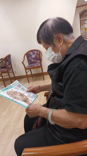</a> | [popo-reading-leaflet.png](popo/popo-reading-leaflet.png) | Popo reading a leaflet; do not infer a particular class or location. |
|  | [popo-in-vehicle.png](popo/popo-in-vehicle.png) | Popo travelling in a vehicle during an outing. |
|  | [popo-ice-cream.png](popo/popo-ice-cream.png) | A further ice-cream outing photograph. |
|  | [newspapers-in-lobby.png](popo/newspapers-in-lobby.png) | Newspapers in the lobby, where our current helper reports collecting the newspaper. |

## our current helper and her relationship with Popo

| Preview | File | Supplied context |
|---|---|---|
| <a href="helper/helper-portrait.png">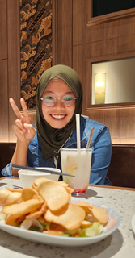</a> | [helper-portrait.png](helper/helper-portrait.png) | our current helper’s portrait, supplied for the introduction/testimonial. |
| <a href="helper/helper-with-popo.png">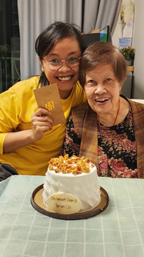</a> | [helper-with-popo.png](helper/helper-with-popo.png) | our current helper with Popo, supplied for the introduction/testimonial. |

## Family-labelled food photographs

| Preview | File | Supplied context |
|---|---|---|
| <a href="food/F01-plain-congee-daliang-milk.png">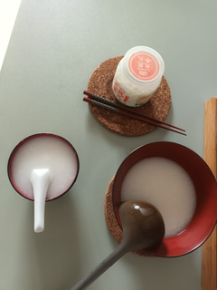</a> | [F01-plain-congee-daliang-milk.png](food/F01-plain-congee-daliang-milk.png) | Plain rice congee with Daliang salted milk / Shunde milk slices Bubur putih dengan Daliang salted milk / Shunde milk slices |
|  | [F02-sweet-corn-egg-milk-honey-water.png](food/F02-sweet-corn-egg-milk-honey-water.png) | Steamed sweet corn, boiled egg, milk and honey water Jagung manis kukus, telur rebus, susu dan air madu |
| <a href="food/F03-scrambled-egg-sandwiches-honey-ginger-water.png">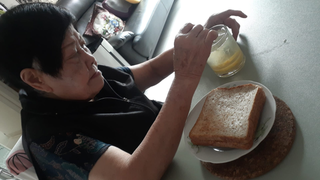</a> | [F03-scrambled-egg-sandwiches-honey-ginger-water.png](food/F03-scrambled-egg-sandwiches-honey-ginger-water.png) | Scrambled-egg sandwiches with honey-ginger water Roti lapis telur orak-arik dan air madu jahe |
| <a href="food/F04-rice-rolls-lemon-honey-ginger-water.png">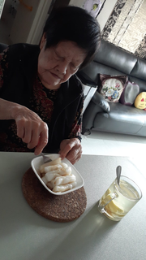</a> | [F04-rice-rolls-lemon-honey-ginger-water.png](food/F04-rice-rolls-lemon-honey-ginger-water.png) | Steamed rice rolls, pepper and soy sauce; lemon-honey-ginger water Gulungan nasi kukus, lada dan kecap asin; air lemon madu jahe |
| <a href="food/F07-fish-congee-lettuce-ginger.png">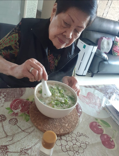</a> | [F07-fish-congee-lettuce-ginger.png](food/F07-fish-congee-lettuce-ginger.png) | Fish congee with Chinese lettuce and ginger Bubur ikan dengan selada Tionghoa dan jahe |
| <a href="food/F08-steamed-sweet-potato-egg-honey-ginger-water.png">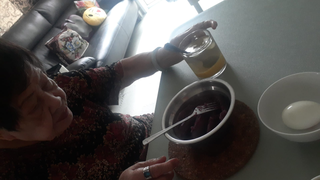</a> | [F08-steamed-sweet-potato-egg-honey-ginger-water.png](food/F08-steamed-sweet-potato-egg-honey-ginger-water.png) | Steamed sweet potato, sometimes with egg, and honey-ginger water Ubi kukus, kadang dengan telur, dan air madu jahe |
| <a href="food/F13-steamed-fish-chinese-lettuce-dinner.png">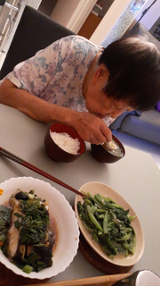</a> | [F13-steamed-fish-chinese-lettuce-dinner.png](food/F13-steamed-fish-chinese-lettuce-dinner.png) | Steamed fish with Chinese lettuce Ikan kukus dengan selada Tionghoa |

## Original-brief food photographs — labels pending

| Preview | File | Supplied context |
|---|---|---|
|  | [R01-2027-brief-page-12-food-label-pending.png](food-label-pending/R01-2027-brief-page-12-food-label-pending.png) | Food photograph extracted from the supplied 2027 brief, page 12; individual dish label/ingredients pending. |
| <a href="food-label-pending/R02-2027-brief-page-12-food-label-pending.png">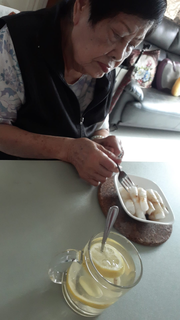</a> | [R02-2027-brief-page-12-food-label-pending.png](food-label-pending/R02-2027-brief-page-12-food-label-pending.png) | Food photograph extracted from the supplied 2027 brief, page 12; individual dish label/ingredients pending. |
|  | [R04-2027-brief-page-12-food-label-pending.png](food-label-pending/R04-2027-brief-page-12-food-label-pending.png) | Food photograph extracted from the supplied 2027 brief, page 12; individual dish label/ingredients pending. |
| <a href="food-label-pending/R05-2027-brief-page-12-food-label-pending.png">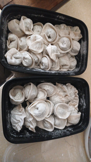</a> | [R05-2027-brief-page-12-food-label-pending.png](food-label-pending/R05-2027-brief-page-12-food-label-pending.png) | Food photograph extracted from the supplied 2027 brief, page 12; individual dish label/ingredients pending. |
|  | [R06-2027-brief-page-13-food-label-pending.png](food-label-pending/R06-2027-brief-page-13-food-label-pending.png) | Food photograph extracted from the supplied 2027 brief, page 13; individual dish label/ingredients pending. |
|  | [R07-2027-brief-page-13-food-label-pending.png](food-label-pending/R07-2027-brief-page-13-food-label-pending.png) | Food photograph extracted from the supplied 2027 brief, page 13; individual dish label/ingredients pending. |
| <a href="food-label-pending/R08-2027-brief-page-13-food-label-pending.png">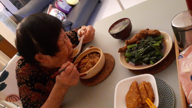</a> | [R08-2027-brief-page-13-food-label-pending.png](food-label-pending/R08-2027-brief-page-13-food-label-pending.png) | Food photograph extracted from the supplied 2027 brief, page 13; individual dish label/ingredients pending. |
| <a href="food-label-pending/R09-2027-brief-page-13-food-label-pending.png">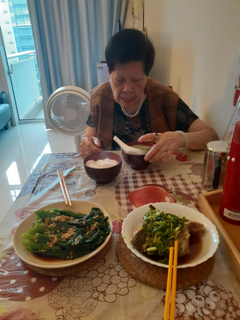</a> | [R09-2027-brief-page-13-food-label-pending.png](food-label-pending/R09-2027-brief-page-13-food-label-pending.png) | Food photograph extracted from the supplied 2027 brief, page 13; individual dish label/ingredients pending. |
|  | [R10-2027-brief-page-13-food-label-pending.png](food-label-pending/R10-2027-brief-page-13-food-label-pending.png) | Food photograph extracted from the supplied 2027 brief, page 13; individual dish label/ingredients pending. |

## Supplied activity screenshot

| Preview | File | Supplied context |
|---|---|---|
| <a href="activity-screenshots/park-exercise-whatsapp-screenshot.png">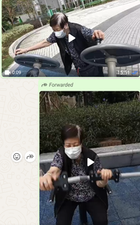</a> | [park-exercise-whatsapp-screenshot.png](activity-screenshots/park-exercise-whatsapp-screenshot.png) | Supplied WhatsApp screenshot of park-exercise video previews; not an actual video or a reviewed exercise demonstration. |

## Existing demo derivatives

The current page still uses these five files without changes: [sunglasses](../photos/popo-sunglasses.jpg), [younger Popo](../photos/popo-young.jpg), [painting](../photos/popo-painting.jpg), [newspaper](../photos/popo-reading.jpg), [second artwork image](../photos/popo-art-ch2.jpg). Some depict the same source photos as the library; they are delivery derivatives, not additional unique moments.

## Duplicate sources

- `breakfast-for-two.png` uses [food/F01-plain-congee-daliang-milk.png](food/F01-plain-congee-daliang-milk.png) — Previously confirmed same photograph.
- `popo-reading-newspaper.png` uses [popo/popo-reading-newspaper.png](popo/popo-reading-newspaper.png) — Exact decoded-pixel duplicate.
- `2027-photo-002.png` uses [food/F02-sweet-corn-egg-milk-honey-water.png](food/F02-sweet-corn-egg-milk-honey-water.png) — Previously confirmed same photograph.

No Chapters 3–6 scaffold has been created. The Chapters 1–2 story, page layout and individual-part narration remain unchanged.
